<!-- Premium dashboard-style GitHub profile — Mamoon Ayoob (@mamoonayoob) -->
<!-- Stats reflect live public GitHub values; widgets update automatically. -->

  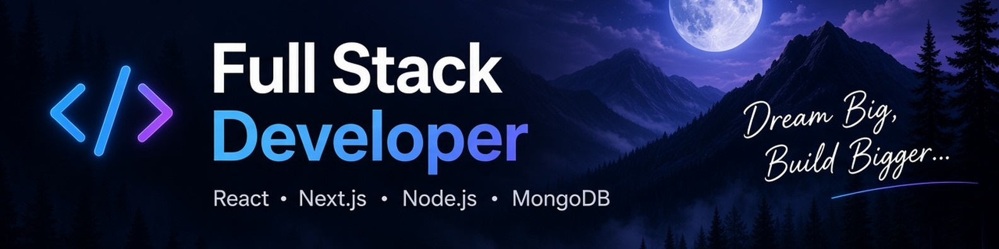

  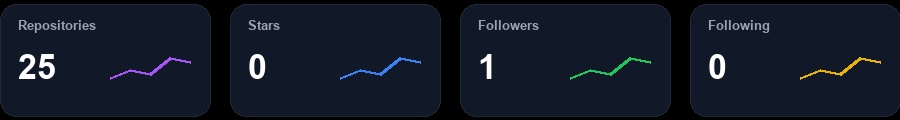

<table width="100%">
  <tr>
    <!-- LEFT: Contribution + Featured Projects -->
    <td width="66%" valign="top">

  

  

 

  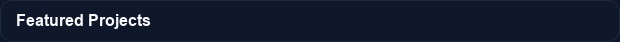

  <a href="https://github.com/mamoonayoob/ESS_Portal">
    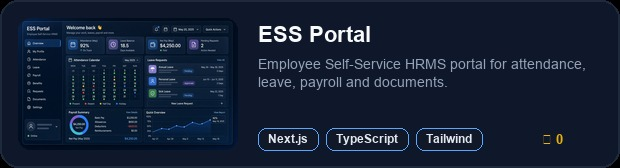
  </a>

  <a href="https://github.com/mamoonayoob/Quick_Mart_Client">
    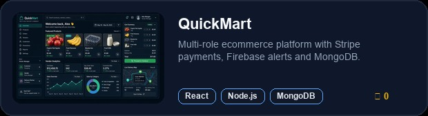
  </a>

  <a href="https://github.com/mamoonayoob/SM2-Racing-ClientSide">
    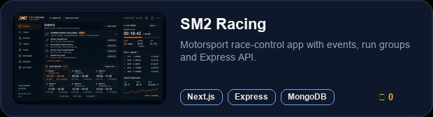
  </a>

    </td>

    <!-- RIGHT: Tech Stack + Achievements + Connect -->
    <td width="34%" valign="top">

  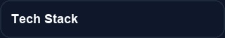

  

  

  

 

  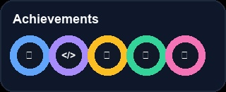

 

  

  <a href="https://github.com/mamoonayoob">
    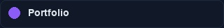
  </a>

  <a href="https://www.linkedin.com/in/mamoon-ayoob">
    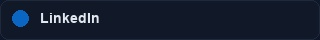
  </a>

  

  <a href="mailto:mamoonayoob@gmail.com">
    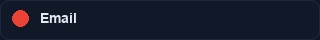
  </a>

 

  

    </td>
  </tr>
</table>

 

  

  MERN Stack Developer @ Tranzo Pvt Ltd · BS Computer Science, UMT · Lahore, Pakistan

